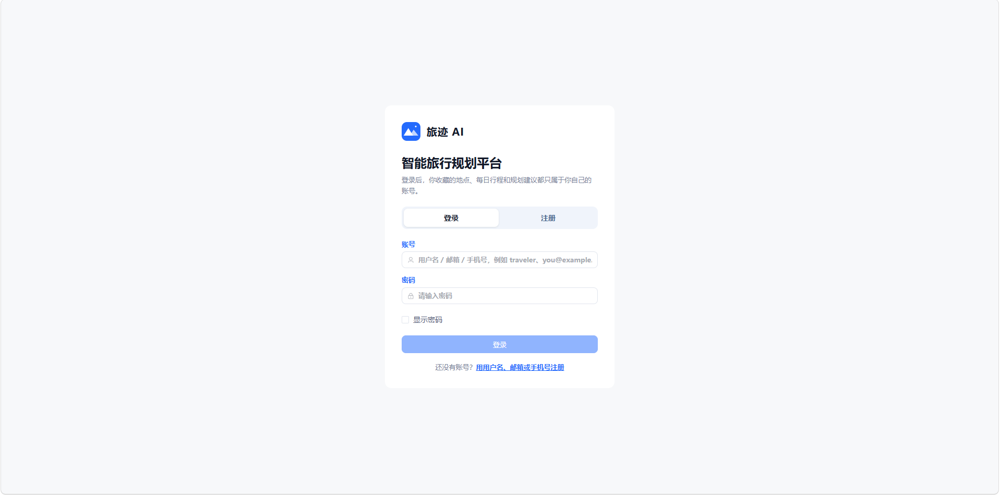
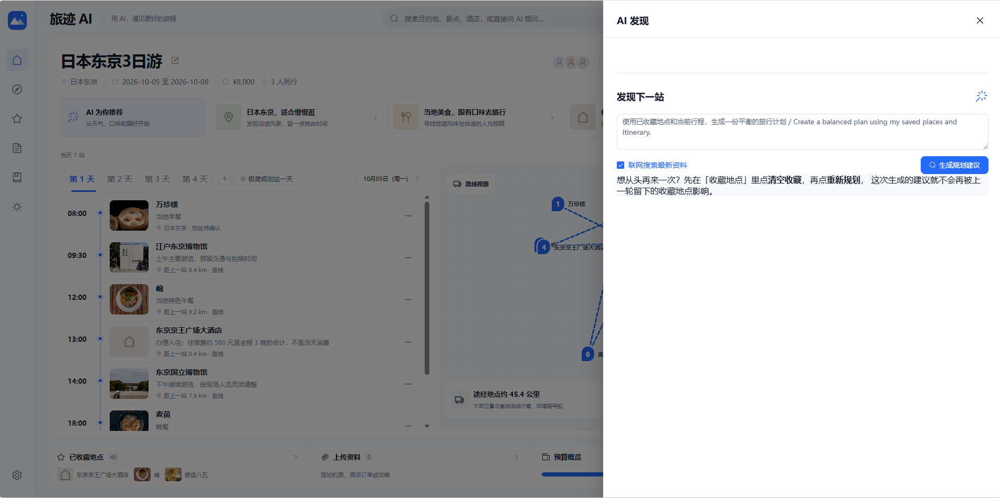
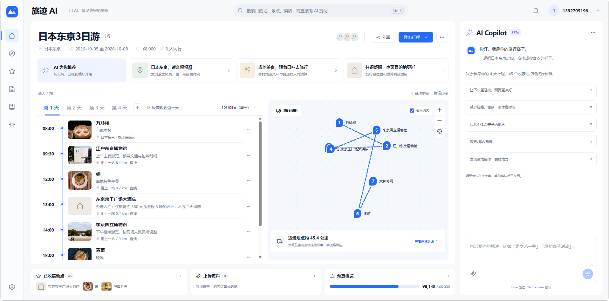

# 旅迹 AI · 智能旅行规划平台

**说出想去哪儿，它去找、去算、去排；每一处改动，都由你点头才生效。**

> AI travel planning platform — AI discovery, day-by-day itineraries, and a Copilot that edits your plan in conversation.


## 这是什么

一个本地部署的 AI 旅行规划平台：给出目的地、日期、同行人和预算，它会联网检索真实素材，抽取成结构化推荐（含图片、价格、营业时间、地址），做预算与时间冲突校验，最后合成一份可编辑的逐日行程。所有模型产出的改动都以**草案**形式给出，用户逐条勾选或修改后才写入行程——AI 负责找与算，你负责决定。

## 功能

- **AI 发现**：用自然语言提问（"有没有更适合亲子游玩的地方，推荐几个？"），联网检索后返回 5 个候选，每个带图片、价格、营业时间、地址与推荐理由；可勾选加入行程，也可逐条改时间、改日期、删除。
- **整趟规划**：一次生成完整行程（多节点 LangGraph 流水线），并提示预算超支与时间冲突。
- **单日极简规划**：只排这一天——两处景点 + 三餐，自动避开其它天已排地点，时间槽不重叠。
- **AI Copilot 调整**：用一句话改行程（"第三天换成室内的""把预算提到 1 万"），先生成草案预览，确认后生效。
- **行程与收藏管理**：景点 / 酒店 / 餐厅 / 机场 / 车站收藏，逐日编排与拖拽调整。
- **多源信息聚合**：地点配图、实时天气、实时价格检索与预算一致性校验、示意图与 Markdown 导出。
- **文件解析**：上传机票、酒店订单、菜单或攻略截图，OCR 解析后人工确认保存。

## 架构

```
用户输入（目的地 / 日期 / 人数 / 预算 / 自然语言指令）
        │
        ├── 检索素材层：联网搜索 + 按「城市+类别+查询」三级键缓存（同城复访零联网检索）
        │
        ├── LangGraph 规划流水线（整趟规划）
        │   load_context → live_search → recommend_places
        │   → analyze_budget_and_conflicts → generate_final_summary → compose_plan
        │
        ├── 调整器（adjuster）：解析指令 → 生成 operations 草案 → 用户确认 → 落库
        │
        └── 单日规划器（day_planner）：类别配额 + 时间槽分配 + 跨天去重 + 素材不足时二次加宽检索
```

**两阶段写入**：`POST /trips/{id}/adjustments` 生成待确认草案 → `POST /trips/{id}/adjustments/{aid}/apply` 才写入行程；未确认的草案可随时丢弃。

## 技术栈

| 层 | 选型 |
| --- | --- |
| 后端 | Python 3.11、FastAPI、SQLAlchemy、SQLite、Pydantic |
| Agent | LangChain / LangGraph（规划器、调整器、单日规划器），DashScope 兼容模式（通义千问） |
| 检索与外部服务 | 联网搜索素材、图片服务、Open-Meteo 天气、OCR 文件解析 |
| 前端 | Vue 3 + TypeScript + Vite + Element Plus |
| 工程化 | pytest（后端）、Vitest（前端）、vue-tsc 类型检查、Docker Compose |

## 本机实测数据

| 指标 | 数值 |
| --- | --- |
| 整趟规划耗时 | 314s → ~195s（引入素材缓存与并行抽取后 **−37.6%**） |
| 单日极简规划 | ~21s（同城命中缓存） |
| 后端测试 | 110+ 条 pytest 用例通过 |
| 前端测试 | 140 条 Vitest 用例通过，`vue-tsc` 零错误 |

> 数据为本机开发环境实测，随网络与模型响应波动。

## 快速开始

> 前置：Python 3.11+、[uv](https://docs.astral.sh/uv/)、Node.js 20+；Docker 仅在使用 Compose 时需要。

### 1. 后端

```bash
cd backend
uv sync                                     # 按 uv.lock 安装依赖到 .venv-ocr
Copy-Item .env.example .env                 # 填入自己的 Key
uv run uvicorn app.main:app --reload --port 8001
```

接口文档：http://127.0.0.1:8001/docs

### 2. 前端

```bash
cd frontend
npm install
npm run dev            # http://127.0.0.1:5173
```

### 3. Docker Compose

```bash
docker compose up --build
```

## 环境变量

在 `backend/` 下由 `.env.example` 复制出 `.env`：

| 变量 | 说明 |
| --- | --- |
| `DASHSCOPE_API_KEY` | 模型服务 Key（必填） |
| `PEXELS_API_KEY` | 图片服务 Key（可选；不填则地点无配图） |
| `PLANNING_MODEL_NAME` | 可选，规划模型名（默认 qwen3.7-plus） |
| `CATEGORY_MATERIAL_CACHE_TTL_HOURS` | 可选，检索素材缓存有效期（默认 24 小时） |
| `TRAVEL_AGENT_DB_PATH` | 可选，自定义 SQLite 数据库路径（默认为 `backend/travel_agent.db`） |
| `AUTH_SECRET_KEY` | 可选，JWT 签名密钥；生产环境务必设置 |

## 项目结构

```
travel-agent-platform/
├── backend/
│   ├── app/
│   │   ├── agents/       # LangGraph 流水线、工具（检索抽取、单日规划、地址、图片）
│   │   ├── api/          # FastAPI 路由
│   │   ├── db/           # SQLAlchemy 会话与初始化
│   │   ├── schemas/      # Pydantic 模型
│   │   └── services/     # 业务服务（规划、调整、认证…）
│   └── tests/            # pytest 用例
├── frontend/
│   └── src/
│       ├── views/        # 页面（行程、发现、登录…）
│       ├── components/   # 组件（日程标签、草案预览…）
│       └── composables/  # 组合式函数（API 封装、状态）
├── docs/                 # 文档与截图
├── deploy/               # 部署相关文件
├── scripts/              # 辅助脚本
└── docker-compose.yml
```

## 截图

<!-- 截图待上传：把 4 张 PNG 放到 docs/screenshots/ 后取消下面的注释即可 -->
<!--




-->

## 说明

- `.env` 与 SQLite 数据库（含个人行程数据）**不纳入版本控制**，首次启动会自动建库；克隆后按上面的步骤配置自己的 Key 即可。
- 项目为个人项目，代码用于学习与作品展示。